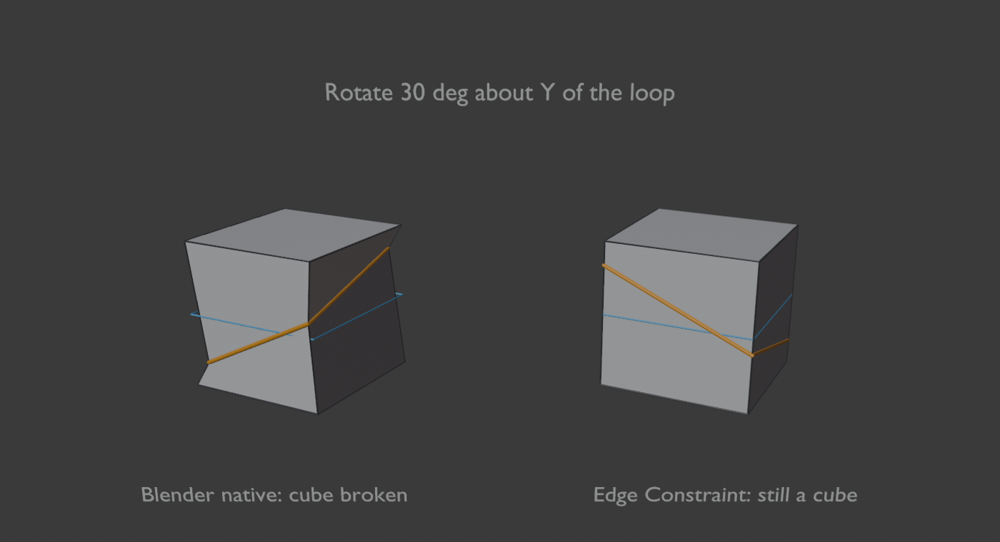
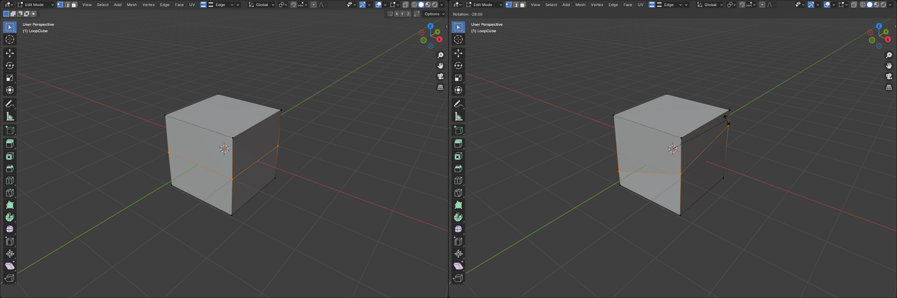
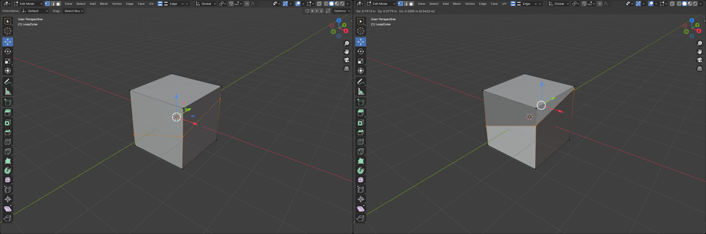
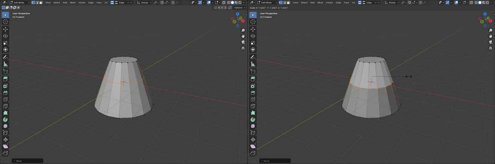
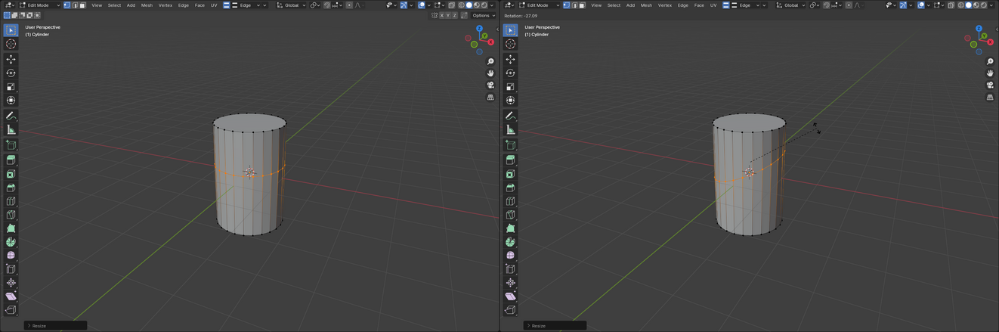
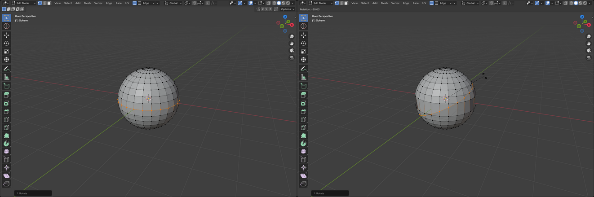
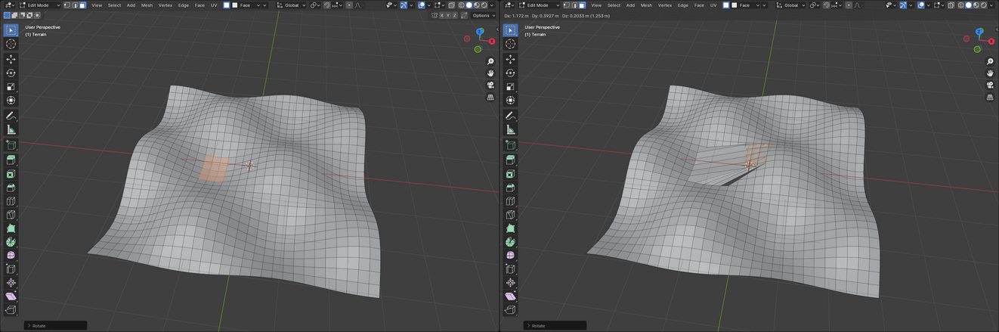
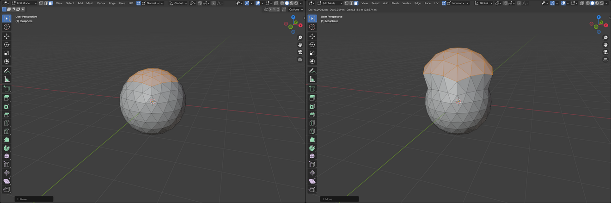
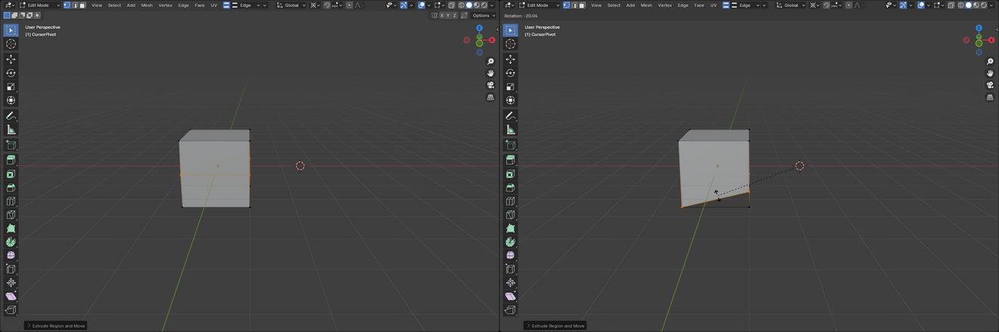
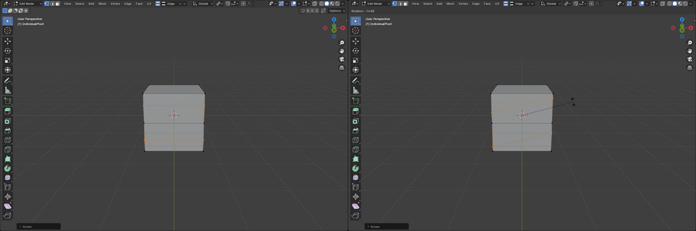

# Edge Constraint Mode

**Version:** 2.1.0 · **Blender:** 4.5+ (built for 5.0) · **Category:** Mesh

3ds Max-style **sub-object constraints** for Blender's Mesh Edit mode. Switch
the constraint on in the header, pick **Edge**, **Face** or **Normal**, and
every Move, Rotate and Scale you do is kept on the mesh. That includes:

- the G / R / S keys
- the toolbar Move / Rotate / Scale / Transform gizmos (W / E / R in the
  Industry Compatible keymap)
- Mesh ▸ Transform, F3 search, and Adjust Last Operation (F9)

Blender's own tools keep working exactly as before (axis locks, typed
values, snapping, pivot settings, proportional editing); the constraint just
keeps the result on the mesh. Switch it off and everything is plain Blender
again. It works like the Constraints dropdown in 3ds Max's Editable Poly.

The classic test: make a cube, add one loop cut, select the loop, switch on
**Edge** and rotate. The loop tilts (shears) across the cube and the cube
stays a perfect cube, because each vertex can only slide up or down its own
vertical edge.

*Left: the constraint off. Right: the same rotate with Edge on. Orange is
the result, blue is where the loop started.*

## In the real viewport

These are screenshots of Blender's own tools, captured live in the middle of
the drag (left: before, right: during).

| | |
|---|---|
| **R key, Edge**: cube loop shears, cube stays a cube |  |
| **Move gizmo drag, Edge**: loop slides only up the edges |  |
| **S key, Edge**: loop slides down the slope of a cone |  |
| **R key, Edge**: cylinder loop tilts, still a cylinder |  |
| **R key, Edge**: sphere equator slides along the meridians |  |
| **G key, Face**: a patch slides over a bumpy surface |  |
| **G key, Normal**: each vertex moves along its own normal |  |

## Install

1. Download `distribution/EdgeConstraintMode_v2.1.0.zip`.
2. **Edit → Preferences → Add-ons → Install from Disk**, pick the zip, enable it.

## Use

1. Enter **Edit mode** on a mesh. Right after the **UV** menu in the 3D
   Viewport header you'll find the constraint controls:
   - the **on/off toggle** (its icon shows the current type)
   - the **type dropdown**: Edge, Face or Normal
   - a small arrow for the settings

   
2. Switch it **on**.
3. Transform however you like: keys, gizmos, menus, typed values, axis
   locks. The constraint follows along live while you drag.
4. Switch it **off** to get unconstrained transforms back.

To give the toggle a hotkey (3ds Max uses **Shift+X**), right-click the
toggle and pick **Assign Shortcut**.

### Pivot points

Rotate and scale use whatever **Transform Pivot Point** you've set:
Median Point, Bounding Box Center, 3D Cursor, Individual Origins or Active
Element. Blender works out the rotation or scale around that pivot, and the
constraint then keeps the result on the mesh. For example, rotating a loop
around a 3D cursor placed beside the cube swings the loop along the edges.
With Individual Origins, two separate loops each tilt around their own
centre.

| | |
|---|---|
| **Pivot: 3D Cursor** (right of the cube), R key |  |
| **Pivot: Individual Origins**, two loops, R key |  |

### What each constraint does

- **Edge.** Each vertex slides along one of its edges, and the direction you
  drag picks the edge. Motion across the edge is ignored. Edges that lead
  out of the selection are the rails, so a selected loop slides along the
  edges that cross it and never along itself. A vertex can carry on past
  the end of an edge if the path stays roughly straight (down a cylinder or
  along a sphere's meridian), but it stops at a sharp corner such as the
  edge of a cube.
- **Face.** Each vertex slides over the original surface and never leaves
  it. It can cross onto neighbouring faces, and off a hard edge onto the
  face next to it.
- **Normal.** Each vertex moves only along its own normal, like a per-vertex
  Push.

## Settings

Click the arrow next to the type dropdown.

- **Reach** sets how far a vertex can travel in one transform: the number
  of edges (Edge) or rings of faces (Face) it can cross. The default is 4.
  Raise it for long slides across dense meshes.
- **Stop at Selected** (Edge) makes a sliding vertex stop when it reaches
  another selected vertex, so two parallel loops can't slide through each
  other.
- **Constrain Blender Transforms** is on by default. Switch it off to leave
  Blender's tools alone and only constrain the **Constrained Transform**
  command (F3).
- **Debug Logging** prints what the constraint did, and how long it took, to
  the system console.

## Good to know

- **Undo / redo** keep the constrained result. **F9** (Adjust Last
  Operation) re-applies the constraint to the new values.
- **Only edits you make yourself are constrained.** Transforms run by other
  add-ons' scripts are left alone.
- **Extrude, Duplicate and similar commands** that move new geometry
  straight away aren't constrained, as in Max.
- **Edge slide and vertex slide** (G G) are left as they are.
- **Proportional editing:** the falloff vertices still move freely; only the
  selected ones are constrained.
- **Very dense meshes** (hundreds of thousands of vertices) can feel slower
  in Edit mode while the toggle is on. The add-on checks the selection on
  every viewport update, so switch it off when you don't need it.
- **Mesh only.** Curves aren't supported yet.

---

[Developer notes](source/DEVELOPMENT.md) · [Changelog](source/CHANGELOG.md)
