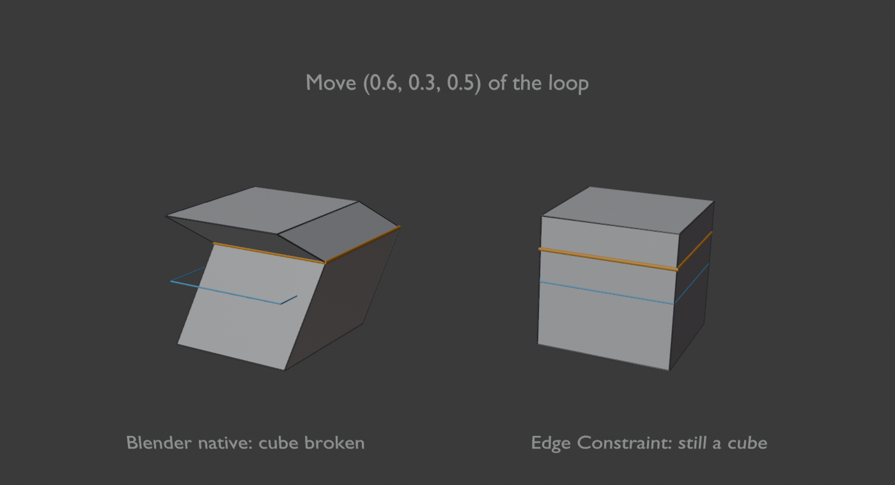
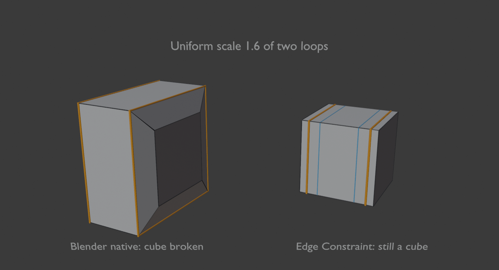

# Edge Constraint Mode

**Version:** 2.0.0 · **Blender:** 4.5+ (built for 5.0) · **Category:** Mesh

3ds Max-style **sub-object constraints** for Blender's Mesh Edit mode. Pick
**Edge**, **Face** or **Normal** in the viewport header and every **Move,
Rotate and Scale** (G / R / S) keeps the selection on the mesh instead of
letting it drift into space. The constraint stays on until you set it back
to **None**, just like the Constraints dropdown in 3ds Max's Editable Poly.

The classic test: make a cube, add one loop cut, select the loop, turn on
**Edge** and rotate it. The loop tilts (shears) across the cube and the cube
stays a perfect cube, because each vertex can only slide up or down its own
vertical edge.

| Move | Scale |
|---|---|
|  |  |

*Left: Blender's own transform. Right: the same transform with Edge
constraint. Orange is the result and blue is where the loop started.*

## Install

1. Download `distribution/EdgeConstraintMode_v2.0.0.zip`.
2. **Edit → Preferences → Add-ons → Install from Disk**, pick the zip, enable it.

## Use

1. Enter **Edit mode** on a mesh. The constraint buttons are in the 3D
   Viewport header: **None / Edge / Face / Normal**, plus a small arrow for
   the settings.
2. Pick a constraint.
3. Select vertices, edges or faces and press **G**, **R** or **S** as usual.
4. While transforming:
   - **X / Y / Z** lock to an axis. Press the same key again for the object's
     Local axis, and a third time to clear the lock. **Shift + X / Y / Z**
     locks to a plane.
   - **Type a number** for an exact value (distance, degrees, or factor).
     **Backspace** deletes, **-** flips the sign.
   - Hold **Ctrl** to snap: 0.1 units when moving, 5° when rotating, 0.1
     when scaling.
   - Press **G / R / S** to switch between move, rotate and scale.
   - **LMB / Enter** confirms, **RMB / Esc** cancels.
5. After confirming, the **Adjust Last Operation** panel (F9) lets you edit
   the values. Undo works as normal.
6. Set the constraint back to **None** and G / R / S are Blender's own again.

### What each constraint does

- **Edge.** Each vertex slides along one of its edges, and the direction you
  drag picks the edge. Motion across the edge is ignored. A vertex can carry
  on past the end of an edge onto the next one if the path stays roughly
  straight (for example down a cylinder), but it stops at a sharp corner
  such as the edge of a cube. Edges that leave the selection are preferred,
  so a selected loop slides along the edges that cross it.
- **Face.** Each vertex slides over the surface of the polygons around it.
  It never leaves the surface, but it can move off a hard edge onto one of
  the faces next to it.
- **Normal.** Each vertex moves only along its own normal, like a per-vertex
  Push.

### Pivot

Rotate and scale use Blender's **Transform Pivot Point** setting: Median
Point, Bounding Box Center, 3D Cursor or Active Element. Individual Origins
falls back to Median Point.

## Settings

Click the arrow next to the constraint buttons.

- **Reach** sets how many edges (Edge) or rings of faces (Face) a vertex can
  slide across in one transform. The default is 4.
- **Stop at Selected** makes a sliding vertex stop when it reaches another
  selected vertex, so two parallel loops can't slide through each other.
- **Debug Logging** prints solver timings to the system console.

## Limitations

- Only the **G / R / S keys** use the constraint. The toolbar Move, Rotate
  and Scale gizmos and the Mesh ▸ Transform menu still run Blender's
  unconstrained transform.
- Mesh edit mode only. Curves aren't supported yet.
- Proportional editing and Blender snapping are ignored while a constraint
  is active.
- On very dense meshes the first frame of a transform can take a moment,
  because the add-on reads the whole edit mesh when the transform starts.

---

[Developer notes](source/DEVELOPMENT.md) · [Changelog](source/CHANGELOG.md)
