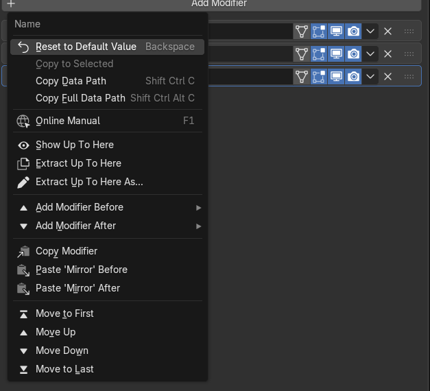
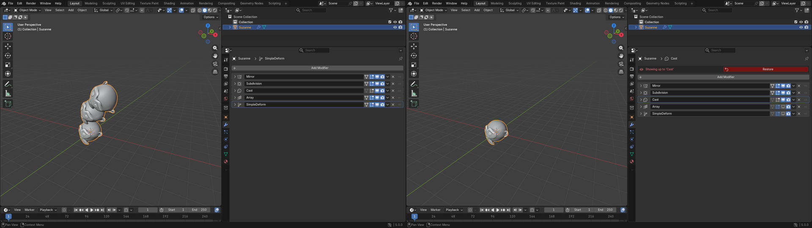
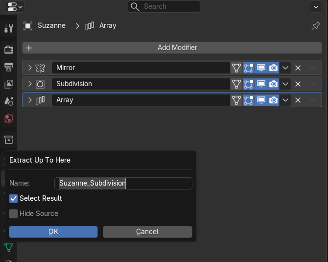
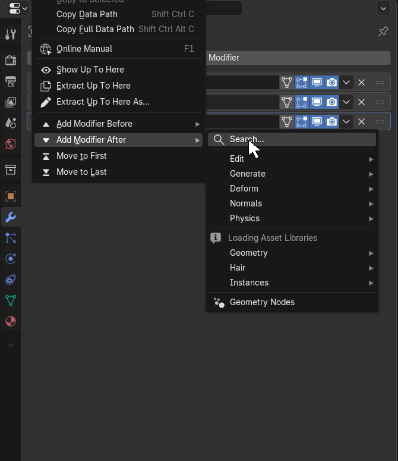
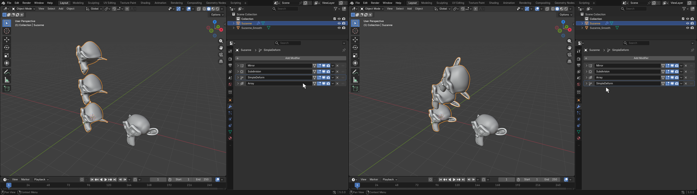

# Modifier Stack Actions

**Version:** 1.1.0 · **Blender:** 4.5+ (built for 5.0) · **Category:** Object

Right-click any modifier in the Modifier Properties to see or grab the stack as it is at
that modifier without touching the modifiers yourself, to add or paste a modifier right
before or after it, or to move it up, down, to the top or to the bottom of the stack.

Full-resolution video: [assets/demo/modifier_stack_actions_demo.mp4](assets/demo/modifier_stack_actions_demo.mp4)
· Step-by-step walkthrough: [TUTORIAL.md](TUTORIAL.md)

## Installation

1. Grab `distribution/ModifierStackActions_v1.1.0.zip`
2. Drag the zip into the Blender window (or `Edit > Preferences > Add-ons > Install from Disk...`)
3. Enable **Modifier Stack Actions**

## Usage

Right-click anywhere on a modifier panel (its header or any of its settings). The entries
appear at the bottom of the menu.

### Show Up To Here

Hides every modifier **after** the one you clicked in the viewport, so you see the result of
the stack up to and including that modifier. A red banner at the top of the Modifiers panel
shows which modifier the preview stops at.

- Right-click the same modifier again (**Restore Modifier Stack**) or press **Restore** on the
  banner to bring the hidden modifiers back.
- **Show Up To Here** on a different modifier moves the preview there.
- Modifiers you had switched off yourself stay off after restoring. Only the ones the tool hid
  come back.
- The preview is saved with the file, so you can still restore it after reopening.
- Only viewport visibility changes. Render visibility is not touched.

### Extract Up To Here

Creates a new object holding the mesh as it is at the clicked modifier: every modifier up to
and including it is applied, nothing after it. Example: on a Mirror → Subdivision → Array
stack, extracting at Subdivision gives you one smooth, mirrored mesh without the array.

- The source object is left exactly as it was.
- The new object is named `<Object>_<Modifier>`, sits at the same place, goes into the same
  collections and has no modifiers.
- A modifier switched off before it stays off. The clicked modifier is used even if it is
  switched off.
- **Extract Up To Here As...** does the same but first opens a small dialog. The name box is
  already filled in with `<Object>_<Modifier>` and selected: type a new name, or press Enter
  to keep it, then Enter again (or **OK**).
- In the Redo panel: **Name**, **Select Result** (on by default, Object Mode only) and **Hide Source**.
- Works on Mesh, Curve, Surface and Text objects, and in Edit Mode.

### Add Modifier Before / After

**Add Modifier Before** and **Add Modifier After** open Blender's regular Add Modifier menu
(Edit, Generate, Deform, Normals, Physics, your Geometry Nodes asset catalogs, Search) as a
submenu. Whatever you pick is placed directly before or after the modifier you right-clicked
instead of at the end of the stack. Type right away to search, like in the normal menu.

Undo takes two steps: the first puts the new modifier back at the end, the second removes it.

### Copy and Paste Before / After

**Copy Modifier** remembers the right-clicked modifier. Then right-click any modifier, on the
same object or another one, and pick **Paste '<name>' Before** or **After**: a copy with all
its settings (Geometry Nodes inputs included) lands right there.

- The paste uses the copied modifier as it is when you paste, so later changes to it come
  along.
- The paste entries are greyed out until something is copied, and again if the copied
  modifier or its object is deleted. Opening another file clears the copy.

### Move Up / Down, Move to First / Last

**Move Up** and **Move Down** shift the right-clicked modifier one slot. **Move to First** and
**Move to Last** send it to the top or bottom of the stack. Entries that would do nothing are
greyed out.

### F3 search

All actions except Add Modifier Before / After are also in F3 search.
Run from there, they use the active modifier.

## Troubleshooting

- **The entries don't appear:** right-click on a modifier panel in the Properties editor.
  Right-clicks in the 3D viewport or the Outliner don't show them.
- **A new modifier still landed at the end:** the Add Before / After pick only applies to the
  next modifier added from that submenu. If anything else changed the stack in between, it is
  added at the end as usual. Use **Move Up / Down**, **Move to First / Last** or drag it
  into place.

Developer notes: [source/DEVELOPMENT.md](source/DEVELOPMENT.md) · History: [source/CHANGELOG.md](source/CHANGELOG.md)
