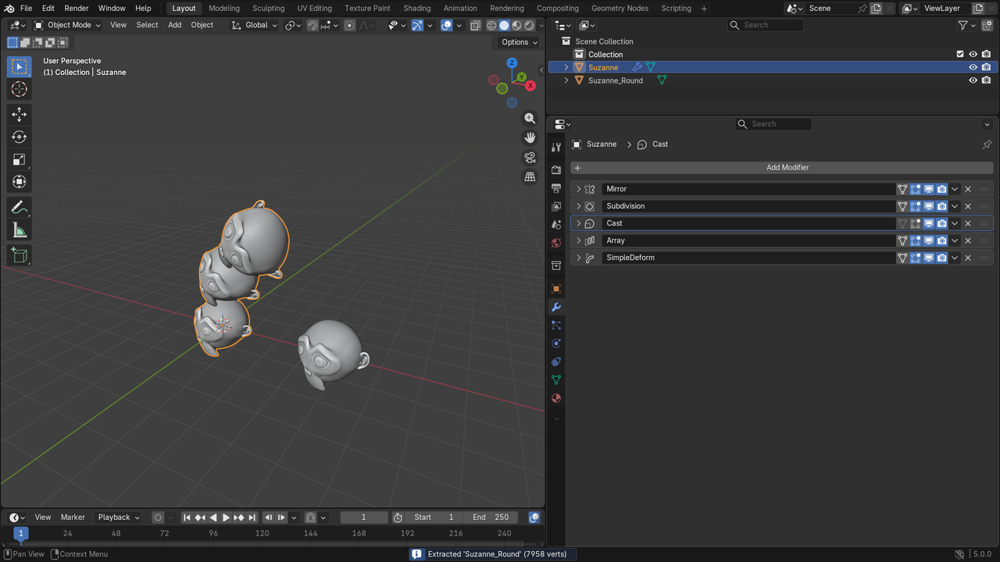
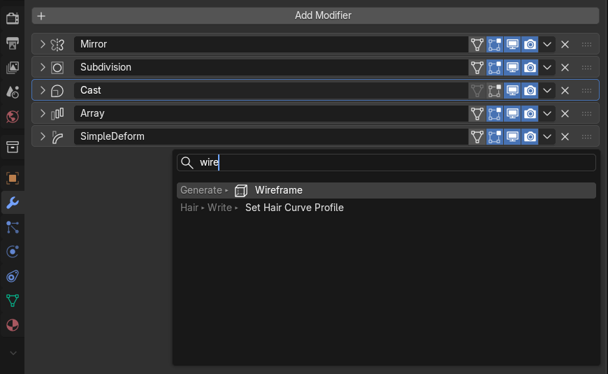
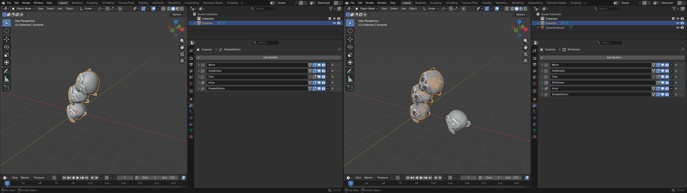
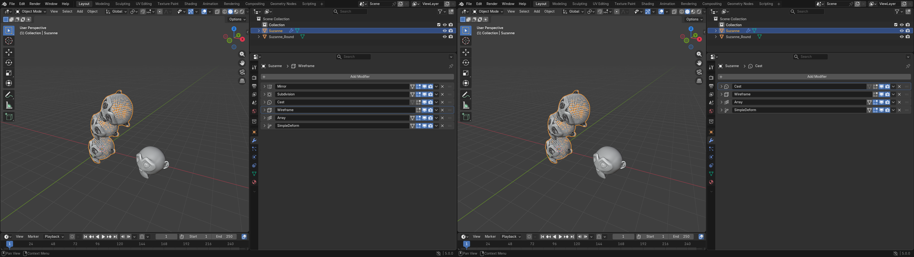
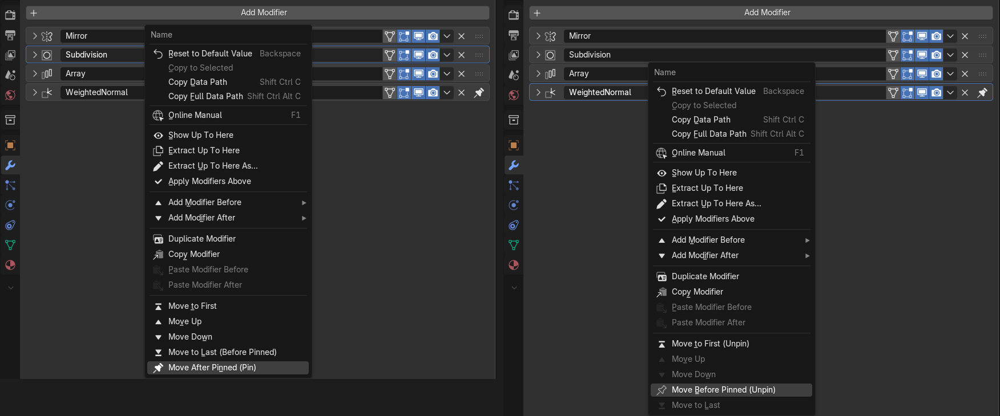

# Modifier Stack Actions — Tutorial

*Applies to v1.2.0 · Blender 4.5+ (screenshots: Blender 5.0)*

This walkthrough follows the demo video
([GIF](assets/demo/modifier_stack_actions_demo.gif) ·
[MP4](assets/demo/modifier_stack_actions_demo.mp4)). Every image is a real Blender window.

---

## 1. The idea

A modifier stack is evaluated top to bottom. To check what one modifier does, you normally
switch off everything below it by hand, then switch it all back on, and hope you didn't miss
one. To keep that intermediate result as a mesh, you duplicate the object and apply modifiers
one by one. To put a new modifier in the middle, you add it at the end and drag it up.

Modifier Stack Actions puts all of that in the right-click menu of the modifier itself, and
every action works **relative to the modifier you right-click**: up to it, before it, after it,
above it.

## 2. The example scene

Half a Suzanne with five modifiers. Everything in this tutorial happens on **Cast**, the one
in the middle:

| # | Modifier | Does |
|---|----------|------|
| 1 | **Mirror** | completes the head |
| 2 | **Subdivision** | smooths it (level 2) |
| 3 | **Cast** | pulls it towards a sphere (factor 0.6) |
| 4 | **Array** | stacks three copies into a tower |
| 5 | **SimpleDeform** | bends the tower (Bend, 90° around Y) |

Collapse the modifier panels if you like. Right-clicks work on the header and on any setting
inside a panel.

## 3. Right-click a modifier

Right-click the **Cast** header (the name field is the easiest target). Below Blender's own
entries you get:

| Entry | What it does |
|-------|--------------|
| **Show Up To Here** | Hide everything after this modifier in the viewport |
| **Extract Up To Here** | New object from the stack up to this modifier |
| **Extract Up To Here As...** | The same, with a name dialog first |
| **Apply Modifiers Above** | Apply every modifier above this one into the mesh, top to bottom |
| **Add Modifier Before ▸** / **After ▸** | Blender's Add Modifier menu, inserting next to this modifier |
| **Duplicate Modifier** | Copy this modifier with all its settings, directly below it |
| **Copy Modifier** | Remember this modifier for pasting |
| **Paste '<name>' Before** / **After** | Paste a copy of the copied modifier next to this one |
| **Move to First** / **Move Up** / **Move Down** / **Move to Last** | Shift this modifier one slot, or send it to the top or bottom. With pinned modifiers in the stack, extra **Move After Pinned** / **Move Before Pinned** entries pin or unpin it |

## 4. Show Up To Here

Pick **Show Up To Here** on Cast. Array and SimpleDeform are hidden in the viewport, so you see
a single round head: the stack exactly as it is after Cast.

The red banner at the top of the Modifiers panel says where the preview stops. To end it,
either:

- press **Restore** on the banner, or
- right-click Cast again: the entry now reads **Restore Modifier Stack**.

Good to know:

- **Show Up To Here** on another modifier moves the preview there in one step.
- Modifiers that were already off before the preview stay off after Restore.
- Only the viewport (monitor) toggle is touched, never render visibility.
- The preview is stored in the .blend. Save, reopen, and Restore still works.

## 5. Extract Up To Here As...

Right-click **Cast** and pick **Extract Up To Here As...**. The dialog opens with the default
name `<Object>_<Modifier>` selected, so you can type over it straight away:

Type `Suzanne_Round` and press **Enter** twice (once to confirm the text, once for OK). A new
object appears with Mirror, Subdivision and Cast applied, but not Array or SimpleDeform. It is
a plain mesh with no modifiers, at the same place and in the same collections as the source.
The video moves it aside so both are visible:

The source object and its stack are not changed at all.

- **Extract Up To Here** (without "As...") skips the dialog and uses the default name.
- The Redo panel (bottom left) has **Name**, **Select Result** and **Hide Source**.
- A disabled modifier *before* the one you click stays disabled. The clicked modifier itself
  is always applied, even if its viewport toggle is off.

## 6. Add Modifier After

Right-click **Cast** and hover **Add Modifier After**. The submenu is Blender's own Add
Modifier menu: all categories, Search, and your Geometry Nodes asset catalogs.

Move into the submenu and start typing. `wire` finds **Wireframe**:

Press **Enter**. Wireframe is inserted directly after Cast, not at the bottom, so Array and
SimpleDeform still run after it and copy and bend the wire version:

**Add Modifier Before** works the same way, inserting above the clicked modifier.

Undo takes two steps here: the first moves the new modifier back to the end, the second
removes it.

## 7. Apply Modifiers Above

Right-click **Cast** and pick **Apply Modifiers Above**. Mirror and Subdivision are applied
into the mesh, one after the other from the top. Cast and everything below it stay live, and
the result looks exactly the same:

- Modifiers switched off in the viewport are skipped and stay in the stack.
- A mesh shared with other objects asks first, then gets its own copy.
- One **Ctrl+Z** undoes the whole apply.

## 8. Moving, duplicating, pinned modifiers

Not in the video, all on the same right-click menu:

- **Move to First** / **Move Up** / **Move Down** / **Move to Last** move the clicked
  modifier. Entries that would do nothing are greyed out.
- **Duplicate Modifier** puts a copy with all its settings right below the clicked one.
- **Copy Modifier** and **Paste Before / After** copy a modifier with all its settings to a
  spot next to the one you right-click, on the same object or another one.
- With **Pin to Last** modifiers in the stack, the move entries say where the modifier lands
  and offer to pin or unpin it (left: a normal modifier, right: a pinned one):

## 9. Quick reference

| You want to... | Right-click the modifier, then |
|----------------|-------------------------------|
| see the result at this point | **Show Up To Here** |
| go back to the full stack | **Restore Modifier Stack**, or **Restore** on the banner |
| keep the result at this point as a mesh | **Extract Up To Here** / **As...** |
| bake everything above into the mesh | **Apply Modifiers Above** |
| add a modifier right here | **Add Modifier Before ▸** / **After ▸** |
| copy this modifier right below | **Duplicate Modifier** |
| move this modifier | **Move Up** / **Move Down** / **Move to First** / **Move to Last** |
| move it past pinned modifiers | **Move After Pinned (Pin)** / **Move Before Pinned (Unpin)** |
| copy this modifier next to another one | **Copy Modifier**, then **Paste ... Before** / **After** |

Everything except Add Before / After is also in **F3** search, where it acts on the active
modifier.
